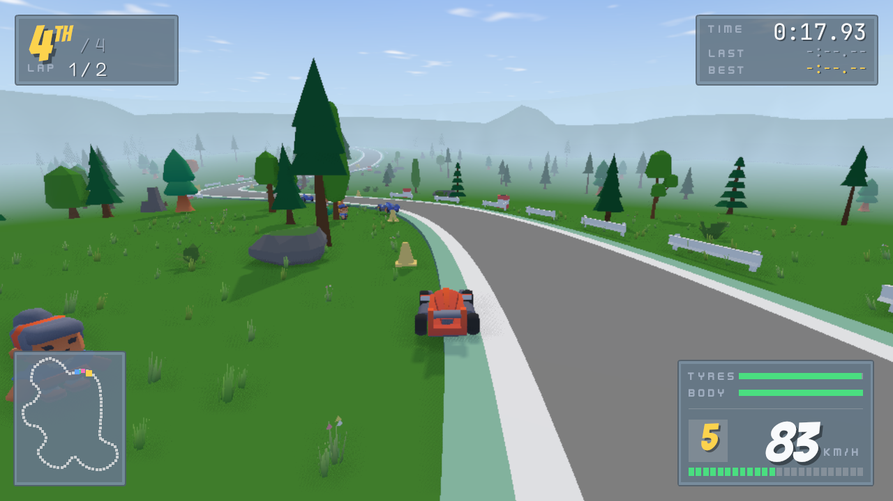
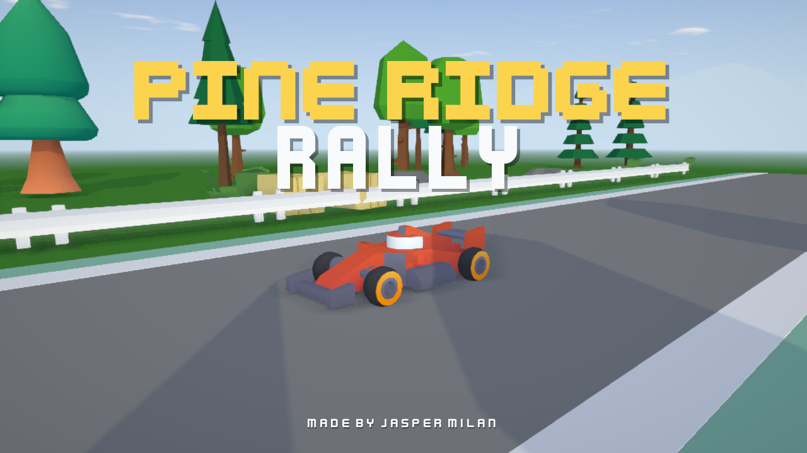
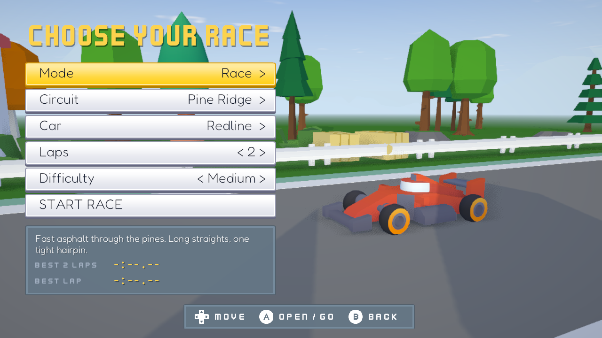
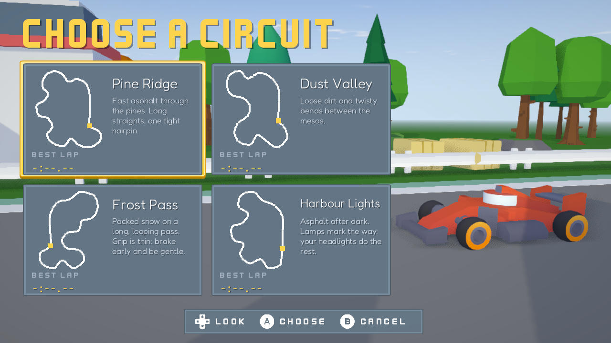
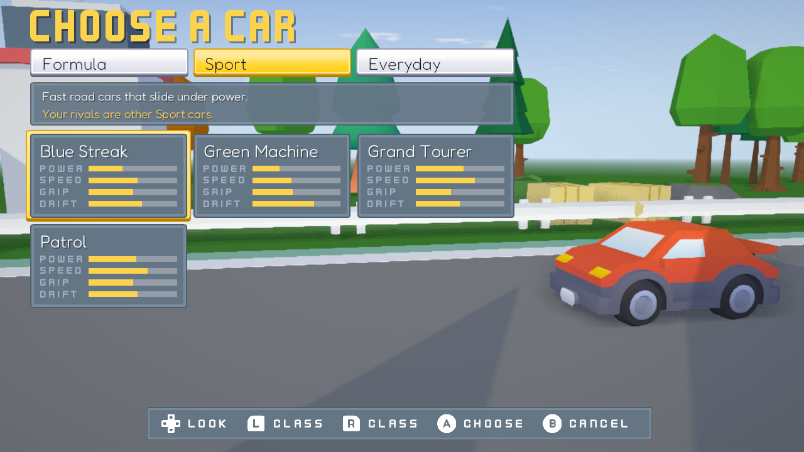
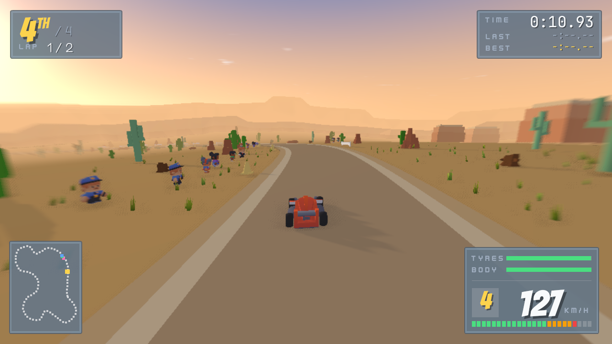
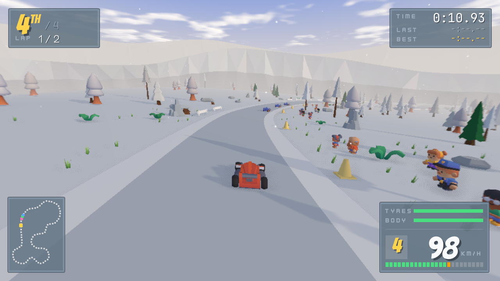
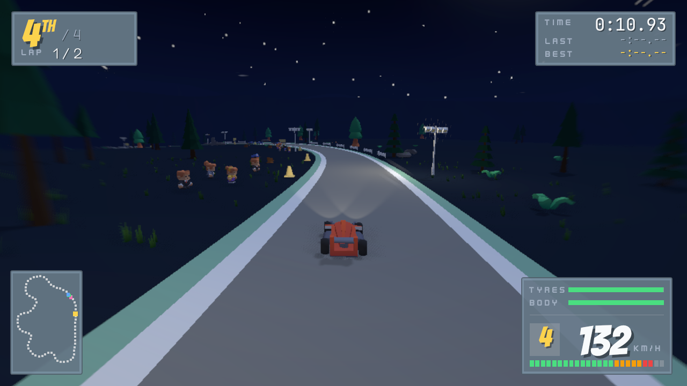
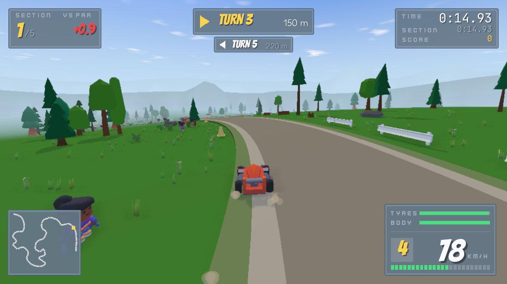
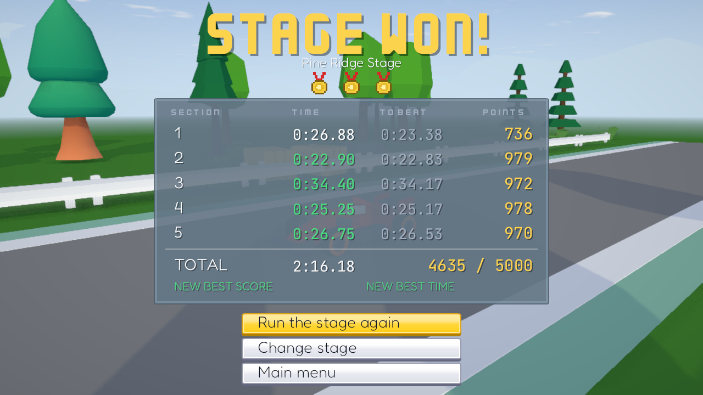

# Nova Studio

**A simple, original studio for making native Android games in 2D and 3D, in the spirit of Game Maker 8.**
Games are written in Lua. The studio has editors for scenes, sprites, 3D models, sound effects, music and race tracks.
Everything you make is a folder of plain files (Lua, JSON, PNG, glTF, WAV/OGG) that the runtime plays directly:
no WebView, no streamed video, no fantasy-console limits. The first target is the Retroid Pocket 6, a handheld with a controller.



Beginners come first: plain words, few choices, good defaults. A project is just files, and the studio never writes code a person
could not have typed.

## What is in the box

- **A Rust game runtime** (`crates/nova-runtime`): a `wgpu` renderer for 2D and 3D, Lua 5.4 gameplay, input actions
  (keyboard and gamepad), glTF models with skeletons, clips and two-bone IK, a C11 sample-clock audio core, and an Android entry point
  (`android-activity`). It runs on desktop, the Android emulator and a real handheld.
- **Nova Studio** (`studio/`): a desktop app (Svelte 5 + TypeScript, Tauri 2) with a project hub, a Lua editor with a Problems panel,
  a scene editor (2D and 3D), a pixel sprite studio, a 3D model editor (parts, painting, animation clips, GLB export), a sound-effect
  generator, a music editor, a track and rally-stage editor, store-art export, a performance strip and a simulation runner.
- **An MCP server** (`studio/mcp/server.ts`, `docs/mcp.md`) so an AI assistant can make the same files the editors make: models, sounds,
  songs, sprites, scenes, race tracks, screenshots and store art.
- **Android export:** `scripts/build-apk.sh` builds a debug APK of any project without Gradle; the studio's Export button does too.
- **Example games** in `examples/`, from a tiny 2D crate game to a full 3D rally game.

### The engine

| | |
| --- | --- |
| Renderer | low-resolution world target (540p by default) scaled to the screen with a sharp-bilinear filter, UI at native resolution; toon shading, outlines, bloom, ambient occlusion, vignette, speed blur and **FXAA** (`nova.look`) |
| 3D | glTF models, skinned animation, masked and additive clip layers, two-bone IK, sun shadows, point and spot lights (budgeted and faded by the engine), GPU instancing, level of detail, fog |
| World | a sun-driven sky (disc, halo, glow, lit clouds, stars, moon), hills (`nova.terrain`: sine waves or a heightmap), wind, snow and rain (`nova.weather`), sprite particles with ground contact, voxel worlds |
| Gameplay | entities, scenes, timers, collisions, cameras, walls and A* paths for indoor 3D, circles, capsules and boxes for scenery |
| Sound | sample-accurate mixer, effect and song renderers made in the studio, reverb room, positional sounds |
| Tooling | headless runner with scripted input and screenshots (`nova run --headless --input play.json --capture out.png`), `nova.hitch` frame-hitch logging, device-loss recovery |

Measured results (and the honest list of what is *not* verified) are in `docs/spike-results.md` and `docs/performance.md`.

## Pine Ridge Rally

`examples/pine-ridge-rally` is a 3D rally game made with the studio's tools, and the project that shaped most of the engine. It is
controller-first (Nintendo-style button labels), runs at 60 fps on a Retroid Pocket 6, and has:

- four circuits (forest, desert at golden hour, snowy pass, a harbour at night) with hills, weather and a crowd,
- **Race** (three rivals, easy / medium / hard), **Time trial** (against your best lap's ghost) and **Rally** (point-to-point stages in five sections, pace notes, a score per section from its time),
- eleven cars in three classes (Formula, Sport, Everyday), each with its own power, top speed, grip, brakes, drift and its own synthesised engine note,
- slipstreaming, tyre wear and damage, skid marks and kicked-up dust, gravel, sand and snow,
- a custom UI built from Kenney's UI pack and Input Prompts, with remappable controls.

| | |
| --- | --- |
|  |  |
|  |  |
|  |  |
|  |  |



**Controls:** left stick steer, ZR / A accelerate, ZL / X brake and reverse, B / R handbrake (slides), Y back on the road, L change
camera, right stick look around, + pause (keyboard: arrows or WASD, Space, R, C, Q/E, Esc).

## Getting started

You need Rust (via `rustup`; `rust-toolchain.toml` picks the toolchain and the Android targets), CMake, Node 22 for the studio, and
for Android builds the Android SDK with NDK 29 and a JDK 17. `scripts/env.sh` sets all of that for one command on the author's
machine (Homebrew and asdf paths); **edit it for yours**, or put the same variables in your shell.

```sh
scripts/env.sh cargo build --release
scripts/env.sh cargo test

# play a game on your computer (F3 shows stats, Esc quits)
scripts/env.sh cargo run --release -p nova-runtime --bin nova -- run examples/pine-ridge-rally
scripts/env.sh cargo run --release -p nova-runtime --bin nova -- run examples/rally-demo

# a headless run with a screenshot at the end (this is how the pictures in docs/images are made: scripts/screenshots.mjs)
scripts/env.sh cargo run --release -p nova-runtime --bin nova -- run examples/pine-ridge-rally --headless --frames 120 --capture build/shot.png

# a game as an Android APK (debug-signed) and as one packed file
scripts/build-apk.sh --project examples/pine-ridge-rally
scripts/env.sh cargo run --release -p nova-runtime --bin nova -- pack examples/crate-dash build/game.npk
```

The studio (run these from `studio/`):

```sh
../scripts/env.sh npm install
../scripts/env.sh npx vite                 # in a browser, with an in-memory project (no runtime needed)
../scripts/env.sh npx tauri dev            # the desktop app (build the runtime first: cargo build -p nova-runtime)
../scripts/env.sh npx vitest run           # front-end tests
../scripts/env.sh npx svelte-check
```

`scripts/build-studio-app.sh --install` builds a macOS app (signed ad hoc, so another Mac asks for approval the first time).

The audio core also builds and tests on its own: `cmake -S audio -B build/audio && cmake --build build/audio && ctest --test-dir build/audio`.

### Make a game

A project is a folder with a `nova.json` and a `main.lua`:

```lua
-- main.lua: a square that follows the arrow keys (Lua, reloaded when you save)
local x, y = 480, 270
function update(dt)
  x = x + nova.input.axis("steer") * 200 * dt
end
function draw()
  nova.clear(30, 40, 60)
  nova.rect(x - 20, y - 20, 40, 40, { 250, 200, 60 })
  nova.ui.text(16, 16, "Hello, Nova", { size = 24 })
end
```

The format and the whole Lua API are in `docs/project-format.md`; the API is also listed with signatures in `studio/src/lib/nova-api.json`
(a test keeps it in sync with the runtime). Start from `examples/crate-dash` (a small 2D game with scenes, entities, collisions and
timers) or `examples/rally-demo` (sprites, 3D models, HUD).

## Examples

| Folder | What |
| --- | --- |
| `pine-ridge-rally` | the 3D rally game above |
| `crate-dash`, `font-gallery`, `sound-check`, `input-test` | small 2D and tooling examples |
| `rally-demo`, `stress` | the renderer's benchmark scenes: sprites, hundreds of models, lights and shadows |
| `skin-demo`, `ik-demo` | skeletons, clips, animation layers and two-bone IK |
| `hill-run`, `sky-garden`, `ember-swarm`, `bunker-run`, `lantern-keep` | 3D games and probes made to find what the engine lacked |
| `blockfield` | a voxel world with day and night |

## Repository layout

| Path | What |
| --- | --- |
| `crates/nova-runtime/` | the runtime: `gfx.rs` (renderer), `game.rs` and `game/` (Lua API), `lua/framework.lua` (entities, scenes, particles), `audio.rs`, `voxel.rs`, `walls.rs`, `ik.rs`, `app.rs`, tests in `tests/` |
| `studio/` | the desktop studio: `src/` (Svelte), `src-tauri/` (Tauri backend), `mcp/` (the MCP server) |
| `audio/` | the C11 audio core and its standalone tests |
| `examples/` | example projects |
| `scripts/` | build and asset scripts (`env.sh`, `build-apk.sh`, `kenney.mjs`, `rally/` for Pine Ridge Rally's content, `lib/` shared generators) |
| `docs/` | project format and Lua API, performance notes, studio tools, the track editor, UX research and the dropped Qt notes in `docs/archive/` |
| `vendor/winit/` | `winit` 0.30.13 with one patch so analogue sticks and triggers reach the game on Android (`NOVA-PATCH.md`) |
| `licenses/` | notices for bundled dependencies, fonts and art |
| `TODO.md` | decisions, milestones and what is next |

## Status and limits

This is early software, made by one person and an AI assistant.

- Games run on the desktop, the Android emulator and a Retroid Pocket 6 (Pine Ridge Rally at 60 fps). Other handhelds are untested.
- Release signing, installing on a device and publishing are left to you; `nova export android` makes debug-signed APKs.
- The audio core and the generated engine and music sounds were checked with offline renders, not by listening.
- The studio edits plain files and has no code-free "drag and drop" logic: games are Lua.
- Not done yet (see `TODO.md`): MSAA, a "play on device" mode over adb in the studio, picking a scene directly for store art, world-space text, streaming of long music files (they are decoded into memory).

## Credits and licences

Nova Studio is released under the **MIT License** (`LICENSE`), Copyright (c) 2026 Jasper Milan. Third-party material keeps its own licence:

- **Kenney** (CC0): the UI pack, input prompts, fonts, interface and impact sounds, music loops, and the car, racing, platformer, nature,
  mini-character and other kits that Pine Ridge Rally and the other examples were built from (converted by the scripts in `scripts/`).
  Thank you, [Kenney](https://kenney.nl). Details in `licenses/kenney-*.txt`.
- **Lua** 5.4 (MIT), **winit** (Apache-2.0, vendored with a patch), **wgpu**, **glam**, **cpal**, **mlua** and the other Rust crates
  (`licenses/rust-dependencies.txt`), the Vorbis/Ogg code (`licenses/vorbis-ogg.txt`), and three.js (MIT, used for the studio's 3D editor views only; `licenses/three-js.txt`).
- **Fonts:** nine open fonts under the SIL OFL (`licenses/fonts/`) and Kenney's fonts (CC0).
- The music and sound effects of Pine Ridge Rally's own set, the engine sounds and the models made in the studio are original and
  covered by the MIT licence of this repository.
- [Pixelorama](https://github.com/Orama-Interactive/Pixelorama) (MIT) and [Blockbench](https://github.com/JannisX11/blockbench) (GPL-3) were
  used as references for ideas; no Blockbench code is included.
