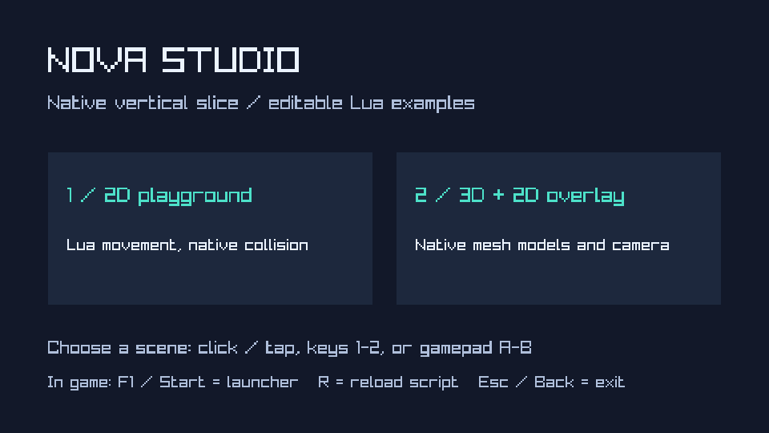
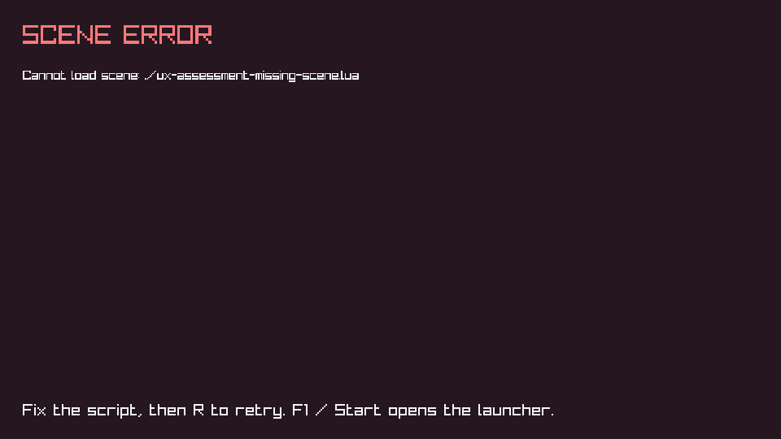
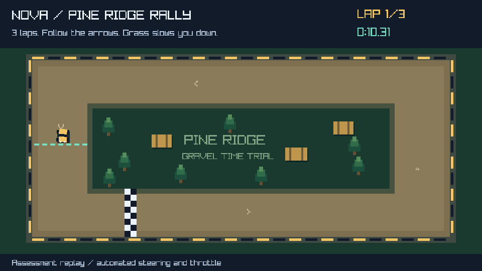
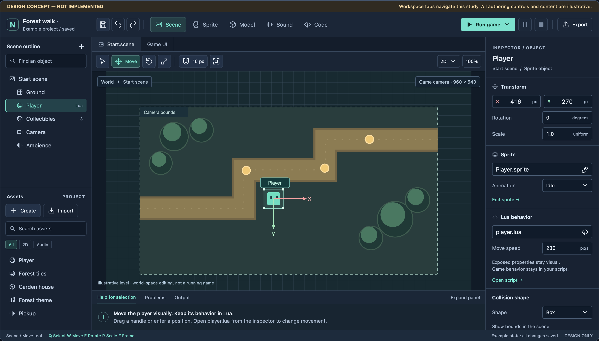
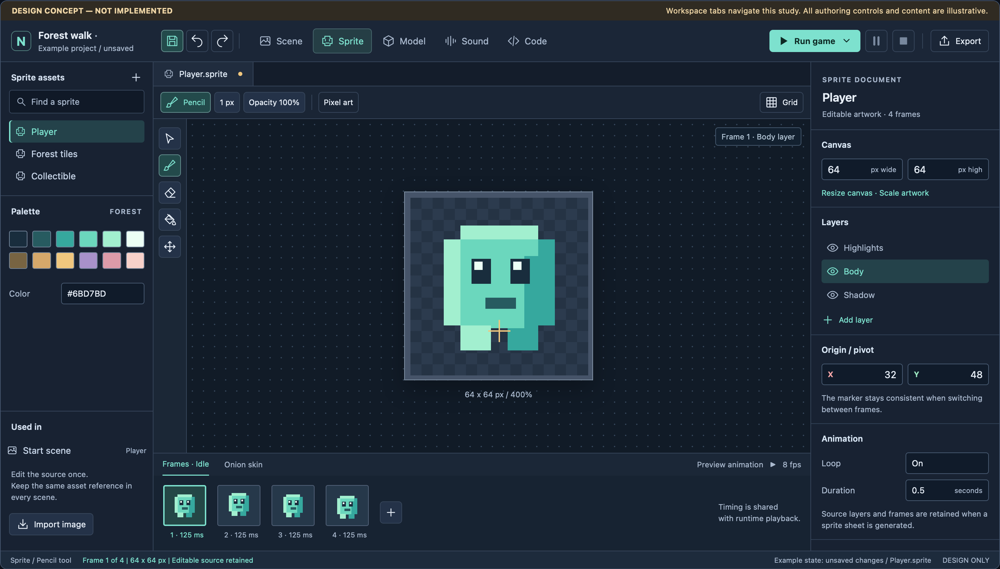
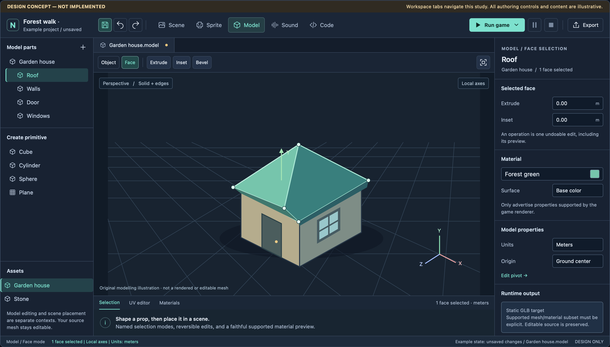
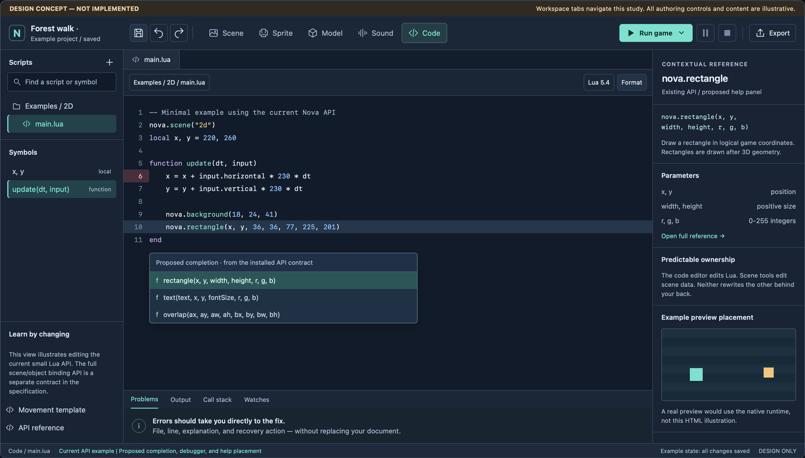
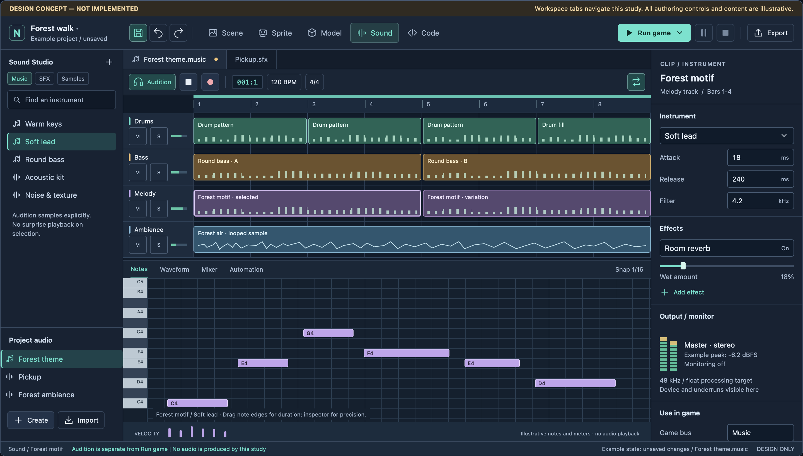

> **Status (2026-11-02):** research retained. Its workflows, layout and Lua-first guidance still inform the studio. Implementation choices named here (Qt, raylib, the shared 960x540 target, the old roadmap and "current state" findings) are superseded by `TODO.md`.

# Nova Studio: UX assessment and studio specification

**Assessment date:** 1 November 2026  
**Baseline:** source commit `918cefa`, plus fresh native captures from this worktree  
**Status:** assessment and proposed product specification, not implemented editor functionality

> **Historical baseline, retained implementation target:** the current-state
> findings in this report describe commit `918cefa`, not the later editor work.
> Implementation now builds on `ffb4c84`, which already includes native assets,
> bounded object/room authoring, source editing, static modelling, basic audio/
> saves and APK export tooling. Those foundations must be reconciled with the
> Lua-first workflows and quality requirements below, not mistaken for completion
> of them. See the [active implementation roadmap](../../TODO.md).
> The design boards remain concepts; they are not screenshots of implemented
> editor features.

**Navigate:** [Current findings](#2-assessment-method-and-current-findings) | [Rally exercise](#rally-workflow-exercise-pine-ridge-rally) | [Editor layout](#5-canonical-editor-layout) | [Lua tooling](#13-making-lua-a-breeze) | [Sound Studio](#14-sound-studio-full-scope) | [Delivery plan](#17-prerequisite-ordered-delivery-plan)

## Executive recommendation

Nova should become **one approachable, Lua-first creative studio**, with visual scene, sprite, model, and sound authoring around a shared native engine. It should feel like a small, well-organized creative tool, not a reduced copy of Unity and not five unrelated applications.

The current app is a credible native runtime demonstration, but **there is no game-authoring interface to polish yet**. Its two launch cards are reasonably aligned, its primary text has strong contrast, and both examples render natively. The important problems are missing workflows and authoring contracts, not poorly positioned existing editor buttons.

The highest-value decisions are:

1. Keep game behavior in hand-written Lua. Make it pleasant through excellent APIs, completion, examples, diagnostics, and debugging, not visual code blocks.
2. Make visual editing operate on structured scene and asset data. Never reverse-engineer or regenerate the user's gameplay scripts to move an object.
3. Use a stable shell: outline and assets on the left, work surface in the center, inspector on the right, and optional detail tools below. Distinguish application commands from document tools and preview controls.
4. Treat saving, undo, recovery, keyboard focus, readable text, and safe Play/Stop behavior as foundational features, not finishing touches.
5. Build a genuine game-focused Sound Studio: composition, instruments, sample editing, recording, sound design, mixing, automation, and reusable game-audio outputs. An audio file picker or a retro sound generator alone does not meet the request.
6. Deliver in prerequisite-backed slices. The existing manifest/import TODO is necessary, but it does not yet include the persistent scene model and transactional editing system that a visual editor also needs.

**This pass changes no engine or application source.** The accompanying [workspace study](nova-studio-workspace-study.html) is an original design reference. Its workspace navigation and diagram sizing controls are interactive; it cannot edit, run, save, model, or play audio. The optional [Pine Ridge Rally exercise](pine-ridge-rally.lua), described below, is a real playable Lua script using the existing native engine, not part of that HTML study.

## 1. Confirmed direction and boundaries

| Topic | Confirmed direction |
| --- | --- |
| Game logic | Lua-first. No visual event/action-block system. |
| Visual work | Scenes, layouts, levels, sprites, models, and music should be visually editable. |
| Beginner experience | Reduce setup, terminology, and memorization; make the next useful action obvious. |
| Sound | A full integrated game-focused music and sound-effect studio, not import-only support. |
| This assignment | Complete the assessment and UX specification first. Implementation follows in separately bounded milestones. |
| Existing architecture | Retain the shared C11/Lua engine and native desktop/Android rendering path. No WebView gameplay, streamed preview, or separate 2D and 3D engines. |
| Platform baseline | Desktop authoring and standalone Android games. Android package verification is not device or editor validation. |
| Independence | Do not depend on, modify, or access save data from GameStudio/Glow43. No compatibility or comparative fidelity claim is established. |

Everything below labeled **proposed** is a design recommendation, not an already selected file format, library, API, or shipped feature. Choosing Lua is a product/workflow decision; visual programming is not inherently slower at runtime.

## 2. Assessment method and current findings

### Evidence

I read `TODO.md`, `README.md`, `AGENTS.md`, the native runtime, engine contracts and Lua registration/update path, the examples, and build integration. I built the existing desktop target in this isolated worktree and inspected native captures of the launcher, both examples, and a deliberately missing scene.

This is an expert, source-backed assessment. It is **not a beginner usability study**, an accessibility certification, an Android device assessment, or a performance benchmark. Captures contain the 960x540 game render target, not a photograph of the physical display. Small-window and high-DPI implications below are derived from source, not claimed as measured screen behavior.



### What is already good

- The launcher is calm and visually balanced. Its two cards share dimensions, spacing, and aligned text insets. There is no evidence that rearranging those two cards would solve the user's actual problem.
- The palette can be retained as a starting identity. Source-color contrast is approximately **15.82:1** for primary text on the background, **9.51:1** for secondary text on the background, and **9.08:1** for mint titles on cards. Low text contrast is not the central defect here.
- Scene choices support direct keyboard shortcuts as well as pointer and controller input. This is useful, although it is not equivalent to normal keyboard focus navigation.
- The same runtime already supports 2D and mixed 3D/2D presentation. That is a valuable basis for a unified project model.
- Errors are visible rather than silently ignored. Native resource ownership and a bounded script runtime are useful foundations to preserve.

### Prioritized findings

**P0** means the requested authoring task cannot be completed. **P1** means a serious usability, accessibility, or work-safety issue for the proposed editor. **P2** means important refinement after a real workflow exists. These are product priorities, not vulnerability severities.

| Priority | Finding and evidence | User impact | Required response |
| --- | --- | --- | --- |
| P0 | `runtime/main.c:93-111` exposes two example scenes, not New/Open/Recent projects. | A beginner cannot start or return to their own game through the app. | Add a project hub backed by a real project manifest. Keep demos as templates/learning examples, not the primary product structure. |
| P0 | `engine/nova.h` has rectangle, text, and cube draw commands; `engine/nova.c:251` clears the frame command list each tick. There is no persistent editable scene/entity model. | A hierarchy, inspector, and transform gizmo have no durable object identities or editable document to operate on. | Add serialized scene data, stable entity IDs, property metadata, and edit transactions before presenting a functioning visual editor. |
| P0 | Scripts are edited outside the app; the Lua API registration at `engine/nova.c:215-222` is deliberately small. | Users must learn filesystem/build behavior before making a simple change; there is no integrated completion, reference, or error navigation. | Provide a Lua workspace and a versioned, discoverable API contract. Keep external editing available. |
| P0 | No sprite/model asset pipeline or authoring documents exist. The examples draw rectangles and generated cubes. | Users cannot make and use real sprites or imported/authored models. | Complete manifest/resource/import foundations, then add real asset editors with round-trip persistence. |
| P0 | Nova exposes no audio service or sound-authoring workflow. Compiling raylib's audio module is not an implemented Nova audio API. | Music/SFX creation and in-game use are impossible today. | Establish native audio ownership and scheduling, then build the Sound Studio described below. |
| P1 | The launcher, error UI, world, and overlay all share one 960x540 texture (`runtime/main.c`, render-target creation and presentation). The minimum window is 480x270. | At that minimum, a 20-unit instruction line becomes roughly 10 screen units and a 16-unit error line roughly 8. Enlarging the window scales the game image rather than laying out crisp editor controls. | Render editor chrome independently at display/UI resolution. Treat game resolution, canvas zoom, and UI scale as separate controls. |
| P1 | Cards have pointer-hover styling and direct shortcuts, but no normal Tab/arrow focus model or semantic UI controls in the launcher implementation. | Keyboard and assistive-technology users cannot rely on familiar control navigation. | Choose an authoring UI layer with real focus, text-input, and accessibility support; add labels, states, and keyboard equivalents. |
| P1 | Runtime control is primarily F1, R, and Esc; there is no visible editor transport, pause state, or distinction between a document and its running copy. | A future author could confuse stop, close, restart, and discard. | Provide persistent, explicitly labeled Run/Pause/Stop controls and a separate preview state. Do not carry "Esc exits the app" into the editor. |
| P1 | `draw_error()` at `runtime/main.c:114-129` displays a fixed number of byte-wrapped lines with generic retry advice. The missing-file capture says to fix the script even when it cannot be found. | Users cannot copy the error, jump to a location, inspect full detail, or take an appropriately targeted recovery action. | Structured Problems panel; file/line links; copy details; distinguish missing resource, syntax error, runtime error, and failed import. |
| P1 | `nova_load()` at `engine/nova.c:188-198` closes the old Lua state and resets the frame. | Reload is a restart, not state-preserving hot reload. That is reasonable for this sample, but must be explicit in an editor. | Initially label the operation "Restart preview." Introduce transactional hot reload only with defined state/resource semantics. |
| P2 | Copy emphasizes "native AABB contacts", "mesh models", and implementation terms. | It explains the engine to its author more than it guides a new creator. | Use task language: "Move the player", "Edit this example", "Create a sprite", "Add a sound". Explain technical terms contextually. |



The current [2D capture](nova-current-2d.png) and [3D capture](nova-current-3d.png) are runtime examples, not screenshots of scene or asset editors.

### Rally workflow exercise: Pine Ridge Rally

The user suggested creating a small rally game to expose actual workflow friction. I made **Pine Ridge Rally**, an original 276-line top-down gravel time trial using only the existing Nova API. It has acceleration, braking/reverse, steering, low-grip grass, bale collisions, ordered directional checkpoints, three laps, a timer, recovery with a penalty, a result screen, and a session-best time.



The game accepts human input: **Space / gamepad A** starts; **W/up** accelerates; **S/down** brakes and reverses; **A/D or left/right** steer; **Space / A** recovers to the last checkpoint for a three-second penalty. The result screen starts another race with Space/A. Existing runtime R reloads the script and resets the Lua session.

Run the human-playable script from this worktree with:

```sh
./build/nova_studio --scene "$PWD/docs/ux/pine-ridge-rally.lua"
```

The native executable is the worktree runtime build. The script is preserved
with this research, not added to the bundled examples. After downloading or
relocating it, substitute its new absolute path.

**What the exercise actually reached:** a start screen, a complete three-lap race, and a result screen in the desktop native runtime. An automated steering/throttle driver completed the race in **34.30 seconds of simulated race time**, without recovery or impacts. The core exercise also covered start gating, grass versus road acceleration, braking, invalid/backwards checkpoint progress, and one-shot recovery behavior. The peak replay frame used **185 of the available 512 draw commands**.

These are functional observations, not a measured human lap time, usability study, framerate benchmark, or Android result. Automated inputs exercised the real Lua movement/checkpoint rules; they did not teleport the car through the race. The [finish capture](rally-finish.png) and [start capture](rally-start.png) are actual native outputs.

| Workflow step | What happened with current Nova | Concrete product issue |
| --- | --- | --- |
| Start a game project | Created a script outside the app and launched it with `--scene`. | No New Project, template-copy workflow, or project identity. |
| Lay out a track and HUD | Wrote coordinates, road areas, bales, trees, gates, labels, and result panels in Lua. | Scene/layout tools would remove a large amount of presentation code without changing game logic. |
| Draw a turning car | Positioned small native rectangle commands around a heading. | No sprite asset or rotation command. This is a visible workaround, not a production sprite workflow. |
| Tune handling | Changed constants in the script and restarted. | Exposed properties, units, a selected-object inspector, and a clear restart/preview loop would make tuning much easier. |
| Handle controls | Used the two axes and held action flag; implemented action-edge detection in Lua. | Named/remappable actions and pressed/released states are missing. This exercise cannot validate separate analog triggers or configurable bindings. |
| Define collision/checkpoints | Used native AABB overlap plus Lua movement and directional gate logic. | The small overlap helper is useful, but there is no visual collision editor or persistent scene object model. |
| Keep a best time | Stored it in Lua only; the UI explicitly says it resets on reload. | No project-scoped persistent save API. |
| Add engine/tire/music audio | Could not implement it through the documented Nova API. No substitute audio system was added. | Native audio is a genuine missing prerequisite, not a panel-design problem. |
| Make a standalone game | Could run the script with the existing desktop host; could not use a selected-project export workflow. | No per-game desktop/Android exporter. The existing sample APK is not a rally-game export. |

**The end-to-end boundary matters:** this exercise reached a playable desktop prototype, not a complete create-assets/compose-sound/export-installable-game pipeline. The missing steps are recorded as blockers rather than being replaced with shell-only solutions and called beginner-friendly.

Use this as a future **golden project** for the authoring workflow: replace the primitive car with an editable sprite, move the track/HUD into scene data, expose handling parameters, add an authored engine loop/tire SFX/music track through the Lua audio API, persist lap records, and export only this game. A later 3D variant can exercise the modeller and supported mesh/material pipeline. Keep its behavior in Lua throughout.

## 3. What to borrow from other tools

These are interaction principles, not requests to copy another product's graphics, source, terminology wholesale, or complexity.

| Reference | Adopt | Deliberately avoid |
| --- | --- | --- |
| [Godot's editor](https://docs.godotengine.org/en/stable/getting_started/introduction/first_look_at_the_editor.html) | Stable docks, selection-driven inspector, contextual viewport tools, an integrated code/reference workflow, folded detail panels. | Making beginners choose among many internal engine concepts before a first visible result. |
| [Unity toolbar](https://docs.unity.com/en-us/engine/6000.0/manual/unity-editor/editor-navigating-managing/toolbar), [hierarchy](https://docs.unity.com/en-us/engine/6000.0/manual/unity-editor/editor-windows-views-reference/hierarchy-window/hierarchy), and [inspector](https://docs.unity.com/en-us/engine/6000.0/manual/unity-editor/editor-windows-views-reference/using-the-inspector) | Consistent run controls, a clear object tree, reusable property editing, explicit selection and parent-child relationships. | Service/account clutter, unnecessary package decisions, and an intimidating inspector full of advanced defaults. |
| [Game Maker 8 global interface](https://documentation.help/Game-Maker-8/106_00_interface.html) | An understandable resource tree; obvious "make a sprite / sound / object / room" entry points; quick iteration; menu and keyboard alternatives. | Floating-window piles, unexplained icon strips, resource deletion that cannot be undone, and hidden capability modes. |
| [Game Maker 8 sprite editing](https://documentation.help/Game-Maker-8/202_01_editing.html) | Integrated creation, frames beside a preview, and a short path back to the game. | Different animation timing in editor and runtime, or a close button that silently has different save semantics from a "close saving" command. |
| [Audacity clips](https://manual.audacityteam.org/man/audacity_tracks_and_clips.html) | Understandable tracks/clips and nondestructive trimming. | Ambiguous hidden audio or destructive edits that are hard to discover. Show trim handles and source extent clearly. |
| [LMMS interface](https://docs.lmms.io/user-manual/navigation/general-interface.md) and [piano roll](https://docs.lmms.io/user-manual/navigation/piano-roll.md) | Distinct composition, note editing, instruments, automation, and mixer functions. | Making every function a separate floating window, or hiding essential loop/edit operations behind undocumented mouse combinations. |
| [Apple toolbar guidance](https://developer.apple.com/design/human-interface-guidelines/toolbars.md) | Logical command grouping, deliberate prioritization, predictable overflow, and standard recognizable symbols. | Treating a toolbar as a dump of every possible command. |

The historical Game Maker source is an archived GM8 manual on a third-party host. It is used to substantiate the classic resource-oriented approach the user likes; this assessment does not claim a separate hands-on GM7 evaluation.

**Synthesis:** classic Game Maker's approachability, Godot's coherent workspace, Unity's consistent selection/inspection model, and a restrained DAW-style audio workflow. Lua replaces visual logic blocks; visual editing remains first-class everywhere it actually helps.

## 4. Product mental model and information architecture

Use a small, consistent vocabulary:

| Term | Meaning in Nova |
| --- | --- |
| Project | The game and its source assets, scenes, scripts, settings, and export profiles. |
| Scene | A reusable visual arrangement. A level, menu, or reusable object assembly can all be scenes; "level" need not introduce another incompatible file type. |
| Object | A persistent scene entity with an identity, transform, optional visual/audio/collision properties, and optional Lua behavior. |
| Asset | A reusable sprite, model, sound, music document, font, or other declared resource. |
| Instance | An occurrence of an asset or reusable scene inside another scene. Editing an instance is not silently editing every use of its source. |
| Script | Hand-written Lua behavior. Visual tools bind properties/references to it but do not rewrite it. |
| Preview | A running, disposable copy of the saved or explicitly staged project state. |
| Export | Build a standalone game from a selected project, not bundle the Studio launcher. |

**Five workspaces:** Scene, Sprite, Model, Sound, Code. These are views into one project, not separate project types. A 2D/3D view selector belongs inside Scene; mixed worlds and 2D HUDs should not force project conversion.

Single-click an asset to inspect it. Double-click or choose **Edit** to open its authoring workspace. Merely selecting a different object must not unexpectedly replace the user's workspace. Changing workspace preserves each document's selection, camera/zoom, scroll, and undo context.

The default navigation is:

```text
Project hub
  -> Project
     -> Scene workspace: arrange objects, levels, and game UI
     -> Sprite workspace: draw and animate artwork
     -> Model workspace: create and edit low-poly assets
     -> Sound workspace: compose, record, edit, mix, and make SFX
     -> Code workspace: write and debug Lua
     -> Run preview / export selected project
```

No separate "beginner project format." Progressive disclosure changes what is initially visible, not what the project can contain.

## 5. Canonical editor layout



### Desktop arrangement

The proposed reference size is **1440x900 logical UI units**. Exact dimensions are starting constraints to validate, not immutable pixel-perfect requirements.

```text
Native app menu: File  Edit  View  Project  Scene  Asset  Run  Help
+--------------------------------------------------------------------------+
| Project / save status | Scene Sprite Model Sound Code | Run game | Export |
+-----------------------+------------------------------+-------------------+
| Outline / selection   | Document tabs                                    |
|                       | Context toolbar                                 |
|                       +--------------------------------+-----------------+
|                       |                                | Inspector       |
|                       | Main work surface              | Selected item   |
|-----------------------| Canvas / viewport / arrangement| Properties      |
| Assets                |                                | Script / refs   |
| Search, type filters  |                                | Help on demand  |
| Create / Import       |                                |                 |
|                       +--------------------------------+                 |
|                       | Optional detail panel          |                 |
|                       | Problems / timeline / notes    |                 |
+-----------------------+--------------------------------+-----------------+
| Context hints | selection / units / zoom | save/import/audio status        |
+--------------------------------------------------------------------------+
```

- Global toolbar: approximately 48-56 units high. Project context left; workspace navigation center; **Run game** and Export right.
- Left dock: approximately 240 units, with scene outline above assets. Allow resizing; do not make a deep folder tree the only way to find an asset.
- Inspector: approximately 300 units, resizable. Primary properties precede advanced foldouts.
- Document strip and contextual toolbar: approximately 34-40 units each. Tools operate on the document beneath them.
- Detail drawer: closed unless needed; around 180-260 units when open. It must not permanently consume half the game canvas.
- Status bar: approximately 24 units. It is supplementary, never the only place to disclose a failed save or import.
- Platform-standard app menus should remain native on macOS, not be imitated inside the game render target.

### Responsive and DPI behavior

| Situation | Required behavior |
| --- | --- |
| 1440x900 and larger | Three-column workspace; optional bottom details; useful viewport area, not decorative empty space. |
| 1280x720 / 1366x768 | Smaller dock defaults, closed detail panel, compact secondary controls. Run, Save, and document identity remain visible. |
| Narrow window or 175-200% UI scale | Collapse docks into explicitly labeled drawers; one auxiliary dock at a time if necessary. Never shrink essential text to preserve three columns. |
| Full work-surface mode | Hide docks with a visible restore action and documented shortcut. Do not trap a beginner in an empty-looking application. |
| Retina / mixed-DPI displays | Text and icons rasterize at the actual display scale. Scene zoom and game output resolution do not alter chrome size. |
| Long names / translated labels | Elide where appropriate with full accessible names and tooltips; do not obscure a destructive action or a property's meaning. |

The accompanying workspace study depicts the large-desktop arrangement. Its illustrative fixed layout is not evidence that these responsive states are implemented.

## 6. Toolbars, icons, and interaction rules

### Command placement

| Command | Icon concept | Placement and behavior |
| --- | --- | --- |
| New / Open project | Document-plus / folder | Project hub and File menu. Avoid permanent duplication in every document toolbar. |
| Save | Familiar save symbol plus status text | Global project/document context. Cmd/Ctrl+S saves the active document; Save All is explicit. Never show "Saved" until persistence succeeds. |
| Undo / Redo | Backward / forward curved arrows | Global edit group or standard menu. Label the operation, such as "Undo move Player". |
| Create asset | Plus | Asset dock, with named choices: Sprite, Model, Sound effect, Music, Script, Scene. |
| Import | Arrow into tray | Asset dock next to Create. Distinguish it from Export, which points out of a tray. |
| Select / Move / Rotate / Scale | Pointer / crossed axes / rotation arc / diagonal scale | One contextual group over the viewport, in that order. Selected tool has a persistent state. |
| Snap / Grid | Magnet / grid | Next to transform tools; expose the actual snap increment, not just an unexplained toggle. |
| Frame selection | Corners around a target | Viewport navigation group. Give trackpad users a reliable way back to their object. |
| Run game | Triangle with visible label | Stable top-right global group. Dropdown offers Run current scene; the main action never changes silently. |
| Pause / Step / Stop | Two bars / step triangle-bar / square | Beside Run. Disabled states explain availability. Stop is not Close or Delete. |
| Preview animation | Triangle with "Preview animation" | Sprite document only. It never starts the game. |
| Audition | Speaker/play with "Audition" | Sound document transport. It never starts the game. |
| Record | Circle with "Record" | Sound transport only. Requires an armed input/track and permission where applicable. Red is not its only indicator. |
| Export game | Arrow out of tray with label | Global right edge, separated from Run and destructive operations. |
| Delete | Trash | Edit/context menu or local panel; do not place beside Run or Save as a primary action. |
| Help | Question mark | Contextual reference, menus, and command search. Never substitute a tooltip for essential instructions. |

Use one original or license-compatible icon family, a consistent 18-20-unit visual grid, and consistent stroke weight. No emoji as application icons; no borrowed engine logos; no mixing platform-specific symbol licenses into cross-platform assets without review.

Primary and unfamiliar actions retain text labels. Common tools can be icon-only in compact mode, but still need an accessible name, a tooltip containing the action and shortcut, and a visible selected state.

### State and focus contract

Every control needs default, hover, pressed, keyboard-focus, selected/toggled, disabled, busy, and failure states where applicable. Selected and focused are different: one identifies the current tool; the other identifies where the keyboard will act.

Pointer activation normally happens on release inside the target, with press-and-drag-out cancel behavior. Drag gestures use pointer capture and finish as one undoable edit. Async operations acknowledge immediately, report progress when meaningful, support cancellation where safe, and leave an explicit failure state.

Recommended desktop hit areas are at least 32x32 units, normally 36 high for frequently used controls. Larger targets are appropriate for future touch authoring; do not claim a dense desktop layout is a touch editor. The [WCAG 2.2 target-size guidance](https://www.w3.org/WAI/WCAG22/Understanding/target-size-minimum.html) is a useful reference, not a native-app compliance certificate.

### Keyboard behavior

- Standard Cmd/Ctrl+S, Z, Shift+Z, C, V, X, A, and F keep platform-appropriate meanings.
- Proposed viewport shortcuts: Q Select, W Move, E Rotate, R Scale; F Frame selection. They apply only when the viewport has keyboard focus.
- Existing runtime R-to-reload must not leak into editor text input or conflict with Scale. Show **Restart preview** separately.
- Space pans a scene only in the scene editing context, auditions audio only in Sound, inserts a space in text, and reaches the game only while the preview owns input.
- Esc cancels the current gesture/dialog or releases captured preview input. It never quits the authoring app.
- Tab/Shift+Tab traverse controls; arrow keys work in trees/lists; Enter activates; context menus have keyboard equivalents.
- All essential mouse gestures have alternatives. Never require a middle mouse button, right-drag, or a three-button mouse to navigate 3D.
- A searchable command palette and shortcut settings expose conflicts and allow remapping. Hover does not transfer keyboard focus.

## 7. Visual system and accessibility

Retain the dark blue/mint identity, but replace the pixel-style UI font with a highly readable system/interface font. Pixel fonts belong in authored games when chosen by the creator, not in every inspector and diagnostic.

**Proposed tokens:** neutral dark canvas, one slightly raised panel surface, subtle but perceptible separators, bright primary text, legible secondary text, restrained mint selection/accent. Use 4/8/12/16/24-unit spacing steps. Avoid oversized card padding once users are doing dense creative work.

Use approximately 14-unit body/control text and 14-16-unit code text by default, scalable independently. Secondary labels must still be readable; do not rely on tiny uppercase labels for essential content. Numeric fields should align and show units. Use color for emphasis, not as the only identifier of an axis, track, warning, or selected object.

The specification adopts **4.5:1 normal-text contrast** and **3:1 meaningful non-text control/focus contrast** as design checks, following the relevant WCAG principles: [text contrast](https://www.w3.org/WAI/WCAG22/Understanding/contrast-minimum.html) and [non-text contrast](https://www.w3.org/WAI/WCAG22/Understanding/non-text-contrast.html). Verify actual tokens and all states, not just a theme's main foreground/background pair.

Accessibility requirements include:

- Semantic controls and screen-reader labels, selected/expanded states, logical reading order, and announced save/import errors.
- Keyboard-accessible trees, numeric editing, menus, dialogs, asset pickers, and alternatives to canvas-only operations.
- Visible focus, reduced-motion support, non-color error indicators, scalable text, and a usable light/high-contrast direction.
- Correct Unicode input, IME composition, text selection, clipboard, and international filenames.
- Trackpad-friendly zoom/orbit/pan; no mandatory middle-button gestures.
- No flashing status effects or surprise audio playback when selecting an asset.

A custom raylib-drawn widget collection is not automatically accessible because it is native. The UI technology must prove these capabilities before it becomes the foundation.

## 8. Beginner onboarding and the first useful session

### Project hub

Lead with **New project**, **Open project**, and recent projects with a thumbnail, path, last-opened time, and explicit missing-folder recovery. Templates and Learn are secondary. No account, network access, package manager, or renderer-choice questionnaire is required for a first local game.

New project asks for a name, location, and a starting template: Empty, 2D starter, or 3D starter. Explain that these are starting contents, not permanent format restrictions. Reject invalid locations inline without losing the entered name. Creating a template copies it into the user's project; it never edits the bundled example.

### Guided first loop

The beginner should be able to:

1. Open a starter and run it immediately.
2. Select the Player in the viewport or outline.
3. Change a clearly named property, such as movement speed.
4. Open its short Lua script from the inspector, read an inline explanation, and change one expression.
5. Create or import an asset and see it in the scene.
6. Stop, undo an unwanted change, save, close, and reopen without losing work.

Use a dismissible task checklist attached to real editor actions, not a modal tour pointing at twenty buttons. Empty panels explain their purpose and offer one relevant action. Help examples must be executable against the installed API version.

Do not force users to learn "AABB", "EGL", "asset handle", or "render target" to make a square move. Technical information remains available in diagnostics and documentation.

## 9. Scene, level, and game-UI authoring

### Scene structure

The outline and viewport selection must stay synchronized. Display type icons, names, hierarchy, and clear scene identity. Creation puts the new object in rename mode. Renaming or moving it must not break data references.

Provide additive selection, rectangle selection, duplicate, group/reparent, undoable delete, alignment, distribution, grid snapping, lock, and editor-only visibility. Clearly separate **Hide in editor** from **Visible in game**. Multi-selection shows "mixed" values rather than inventing a common zero.

The inspector uses a consistent order: identity/type, transform, visual or audio resource, collision/interaction settings when supported, Lua behavior and exposed properties, then advanced details. Defaults should produce visible results. Properties explain their units and constraints inline.

Reusable object assemblies need explicit **Edit source**, **Make unique**, and **Revert override** semantics. Do not introduce nested inheritance complexity before a simple source/instance model works.

### 2D levels

Offer object placement, sprite drag-and-drop with a placement ghost, layers, tile painting when tilemap data exists, guides, grid size, camera bounds, and collision visualization. Invalid drops show why they are invalid; they do not silently do nothing.

Distinguish image pixels, scene coordinates, screen coordinates, and canvas zoom. Preserve the current runtime's coordinate behavior until an intentional versioned change is approved.

### 3D scenes

Provide orbit/pan/zoom, Frame selection, labeled axes, perspective/orthographic views, a ground grid, transform gizmos, numeric editing, local/world transforms, and snap increments with units. Make "where is my object?" recoverable in one action.

Keep +Y-up for 3D consistent with the existing camera. Clarify 2D's screen-oriented coordinates rather than pretending both views have identical axes. The current native AABB helper is not a full 3D physics engine; a collision checkbox cannot imply one exists.

### Game UI and mixed scenes

Offer a **World / Game UI** editing context within the same scene. Game UI needs anchors, margins, alignment, layout containers, text, image, and button properties, plus safe-area/aspect previews. Hooking a button to behavior creates or navigates to a Lua callback, not a visual logic graph.

The authored game's UI is different from the Studio's UI. A separate native-resolution HUD/world presentation contract must exist before promising crisp game HUDs at arbitrary resolutions. The current shared 960x540 target does not deliver that.

## 10. Asset workflow and import UX

The asset browser supports search, type filters, folders, list/thumbnail views, sensible thumbnails, and a visible Create/Import pair. Default beginner categories can be Scenes, Sprites, Models, Sounds, Music, Scripts, and UI; they are filters, not rigid filesystem restrictions.

Import is a transaction: choose or drop a source, show supported features and any relevant choices, validate, generate/cache derived data, register stable identity, then reveal the usable asset. Failures retain the source and explain exactly what failed.

Required cases include duplicate names, unsupported formats/features, missing textures, oversized assets, interrupted import, modified external sources, and renamed/moved files. Show dependencies and affected scenes before deleting or replacing a shared asset. Undo must restore identity and references, not merely recreate a file with a new ID.

**Source, editable document, and runtime output are distinct.** A layered sprite is not only its exported PNG. A music arrangement is not only a WAV. A modelling document is not only a flattened GLB. Keep originals and editable sources; derived caches can be rebuilt.

Do not silently enable general filesystem access in Lua to solve asset lookup. The manifest and native registry remain responsible for validated project resources.

## 11. Sprite Studio



The desired scope is a useful small image/animation editor, not just an image preview.

| Region | Contents |
| --- | --- |
| Left tool rail | Select, pencil/brush, eraser, fill, line, rectangle/ellipse, eyedropper, move. Group drawing, selecting, and transforming tools. |
| Center | Zoomable canvas, optional pixel grid, checkerboard transparency, visible selection bounds, and an unobtrusive origin/pivot marker. |
| Right | Layers, palette/color editor, tool settings, sprite dimensions, pivot, and supported collision metadata. |
| Bottom | Frames, durations, playback range, named animations, onion skin, and a dedicated animation preview. |

Support both pixel-art and smooth raster workflows. Pixel mode uses integer zoom and crisp pixels; it should not force all art into low resolution. Clearly distinguish **Resize canvas** from **Scale artwork**, with previews for cropping/resampling.

Required behavior includes layers and visibility/locking, transparent drawing, selections and transforms, clipboard, named palettes, frame duplication/reordering, adjustable frame durations, onion-skin opacity, and undo grouped by brush stroke/gesture. Animation timing must agree with runtime playback and must not depend accidentally on the game's simulation frequency.

Pivot and collision bounds should be visible in the preview and in Scene. Linking or overriding these properties between an asset and an instance must be explicit.

**Definition of done:** draw an original multi-frame sprite, save editable layers/frames, close/reopen, place it in a scene, play its animation correctly, change the artwork, and see an intentional updated preview without losing its asset references.

Sprite animation metadata and playback are additional runtime contracts; the existing rectangle API does not provide them.

## 12. Model Studio



The appropriate initial ambition is an **original beginner-friendly low-poly modeller**, not a Blender clone and not a cube arranger marketed as full modelling.

Start with primitives, selecting, moving, rotating, scaling, snapping, duplication, grouping, origin/pivot editing, and simple materials. Then add the mesh editing needed to make useful original assets: vertex/edge/face selection, extrude, inset, a bounded bevel tool, basic cuts, mirror, face normals, and simple UV editing/unwrapping.

The layout uses the same shell: object/part list left, viewport center, properties/materials right. Context tools change when Object, Vertex, Edge, or Face mode changes. The active mode must be plainly named; different selection modes cannot be distinguished only by a small icon.

Show unit scale, axes, selection statistics, triangle counts, unsupported material warnings, and Frame selection. Gizmos and numeric fields are equivalent ways of editing. Applying a destructive mesh operation must be undoable; importing a mesh never overwrites its original source.

Materials must reflect what the runtime actually renders. A beautiful PBR-looking editor preview is misleading if export only supports an unlit/base-color subset. Document the first supported GLB/material feature set and visibly reject or explain unsupported features. Skeletal animation, sculpting, advanced retopology, and full PBR/shadow parity require additional milestones.

**Definition of done:** create an original low-poly object, edit its geometry and material, save/reopen its editable document, export/import the supported static GLB subset, place it at the correct scale in a scene, and preserve geometry/material appearance within the declared runtime subset.

## 13. Making Lua a breeze



The goal is not merely syntax coloring. Nova needs a small, consistent API and an editor that understands it.

### Editor capabilities

- Completion for the installed Nova API, parameters, project assets, scene references, and exposed properties.
- Signature help, hover documentation, go-to-definition, find references, rename where safe, formatting, and inline syntax diagnostics.
- Short behavior templates such as movement, camera follow, trigger response, and play a sound. Templates are editable Lua, not locked generated behavior.
- A contextual "Open script" action on an object and a "Reveal object" action from a bound script/property.
- Clickable errors with file/line/context; an understandable call stack; breakpoints, step controls, watches, and an object/state inspector when the debugger milestone ships.
- Offline searchable API reference with runnable examples, version badges, and clear unsupported/deprecated features.
- External-editor support, with conflict-aware reload rather than blindly overwriting either side.

Godot's [script-template approach](https://docs.godotengine.org/en/stable/tutorials/scripting/creating_script_templates.html) is a useful reference for discoverable starting points.

### API contract requirements

| Area | Requirement |
| --- | --- |
| Naming and shape | Consistent names and argument order; structured options where long positional lists become unreadable. Preserve existing APIs or provide explicit versioned migration. |
| Lifecycle | Document initialization, fixed update, input, and teardown. New per-object behaviors must not silently change the existing scene-level `update(dt, input)` contract. |
| Properties | Safe, statically discoverable property metadata: type, default, units, range, enum choices, help, and asset/entity reference type. Do not execute arbitrary scripts merely to display an inspector. |
| References | Bind stable references through the inspector or editor-assisted insertion. Users should not hand-copy UUIDs or rely on fragile object-name strings. |
| Input | Named actions/axes with held, pressed, and released states; keyboard/controller mappings editable as project data. Preserve existing sample input until a migration path exists. |
| Scene/objects | A small persistent object API shared by visual scenes and Lua, with explicit lifetime and invalid-reference errors. Do not mistake per-frame draw commands for persistent entities. |
| Assets | Validated handles and clear readiness/failure states. Decode/upload once through native ownership, not inside every Lua update. |
| Audio | One-shot and streaming playback, voice handles, buses, volume/fades, stop, and loop/cue controls. No Lua work on the real-time audio callback. |
| Modules and persistence | Project-scoped module loading and explicit save APIs when implemented; not unrestricted filesystem/process libraries. These services are absent today. |
| Errors | State the operation, expected type/range, received value, and source location where available. Do not expose a raw C assertion as the beginner's primary explanation. |

Generate API reference data, completion/type annotations, examples, and validation metadata from a common contract where practical. Lua annotations can improve tooling without changing Lua into another language.

Default preview changes are **restart-based**. A later safe-reload system must stage parsing/validation and resource updates before replacing the running state. If a change requires a restart, say so. Never advertise "live reload preserves your game" when it destroys the Lua state.

## 14. Sound Studio: full scope



**Product definition:** a self-contained, game-focused composition and sound-design environment. Users can make music and sound effects without a separate DAW, while still importing/exporting standard audio and keeping editable source documents.

GameStudio is an experience reference supplied by the user, not a verified technical baseline. No GameStudio/Glow43 code or save data was inspected. "Higher fidelity" must be specified and measured independently; it cannot be claimed from a larger sample-rate number or a louder output alone.

### Workspace layout

The global Run game controls stay where they are. Inside Sound:

- **Top local transport:** Audition, Stop audition, Record, loop, time/bar position, tempo, time signature, metronome, snap, and output/device status.
- **Left browser:** instruments, samples, SFX recipes, presets, and project sounds. Audition is opt-in; selecting a file must not startle the user.
- **Center:** arrangement lanes with named tracks and clips. Track names, mute, solo, arm, and meters are aligned.
- **Right inspector:** selected clip/instrument/processor settings with readable units, typed values, reset, and contextual help.
- **Bottom detail area:** Notes, Waveform, Mixer, or Automation. Open the relevant editor from a selected clip; do not show every possible audio panel at once.

Music, sound effects, and samples use task presets within Sound, not three unrelated applications. A song project and its rendered music asset remain linked.

### A. Music composition

Provide a linear arrangement, pattern clips, drum/step sequencing, piano-roll note entry, velocity, quantization, swing, scale guides, clip duplication, loop ranges, and named sections. A blank music document starts with a useful instrument and a short explanation, not an empty routing graph.

Dragging a note moves it; dragging its edge changes duration; selection and erase remain explicit tools. Numeric note/time editing provides a keyboard alternative. Quantization is an intentional operation or preview, not destructive magic on every import.

Built-in synth and sampler instruments, original/license-cleared starter patches, and MIDI note input make the composer usable without buying plugins. Imported MIDI needs a clear instrument-assignment step because notes are not audio.

### B. Sound-effect design

Provide layered tonal, noise, and sample sources; pitch and amplitude envelopes; filters; modulation; duration; fades; and bounded variation. Begin with task-oriented recipes such as UI click, impact, pickup, whoosh, and ambience.

Presets are starting points, not only fixed retro effects. Keep layer balance and envelopes visible. A Randomize action should support locked parameters, bounded ranges, a stored seed, undo, and before/after audition. It must not destroy the last useful sound.

Every generated SFX retains its editable recipe as well as its rendered audio.

### C. Sample and waveform editing

Provide nondestructive trim, split, move, fade, loop markers, crossfade, reverse, gain, channel handling, and precise time/sample navigation. Show hidden source extents so users know a trim can be restored. Keep originals untouched.

Recording requires explicit input selection, track arming, permission handling, level indication, and a clear recording state. Input monitoring starts off to avoid accidental feedback. Device loss should stop/mark the recording safely and retain the captured material rather than claiming success.

Time-stretch/pitch tools need a quality preview and honest limitations. Advanced spectral restoration and professional vocal correction are not prerequisites for a useful game-focused studio.

### D. Mixing and processing

Provide track gain/pan, mute/solo, insert chains, sends/returns, buses, and master controls. Built-in processors should cover EQ/filter, compressor, limiter, delay, reverb, and useful modulation/saturation, with bypass and an understandable dry/wet or amount control where appropriate.

Track mix channels and game runtime buses are related but different concepts. A rendered music asset may contain many instrument tracks and still route to the game's single Music bus. Runtime buses such as Master, Music, SFX, UI, and Ambience should be presented separately from internal song tracks.

Routing must prevent unsupported feedback cycles. If processors add latency, compensated timing must be defined before claiming synchronized rendering. Always show unclipped level information; a master limiter is not a substitute for gain staging.

### E. Automation and game integration

Expose automation lanes for meaningful parameters: gain, pan, filters, instrument controls, and effect amounts. Curves need explicit interpolation and units. Editing an automation point is undoable, with precise numeric entry.

Export mixdowns, loops, and stems with deliberate tail handling. "Loop" means a validated seamless region, not merely replaying a compressed file from its beginning. Preserve loop metadata and clarify whether endpoints are start-inclusive/end-exclusive.

Use in game should be short: create sound, save, assign it to an object/property, open the relevant Lua callback/template, and preview. Include audition through the **runtime output profile**, so mobile downmix/resampling/compression differences are heard before export.

Spatial audio, cue transitions, and interactive stems can build on explicit runtime contracts; do not imply that authoring tracks alone provide these features.

### F. Fidelity and reliability targets

These are **proposed engineering targets**, not current capabilities or measured results.

| Area | Proposed target and qualification |
| --- | --- |
| Working audio | Stereo 48 kHz default project rate, with explicit 44.1 kHz support and deliberate conversion. Preserve original sources; support hardware rates through the audio backend rather than relabeling samples. |
| Internal processing | 32-bit floating-point DSP/mixing or better where justified. This provides processing headroom; it does not by itself guarantee better audible quality. |
| Master files | Lossless editable sources and 24-bit PCM or floating-point WAV masters. Use appropriate dithering when reducing to integer precision; do not dither repeatedly at each internal stage. |
| Synth/effect quality | Band-limited oscillators where appropriate, controlled aliasing in nonlinear processing, smooth parameter changes, no clicks on voice start/stop or intentional fades. Establish objective and listening checks. |
| Timing | Sample-clock scheduling for notes, automation, loop boundaries, and rendered stems. A 60 Hz gameplay tick is not an adequate music sequencer clock. |
| Monitoring | Peak and clipping indicators; a clear output level. Loudness/true-peak analysis belongs in final mix/export tools. No forced loudness normalization without an explicit user choice. |
| Responsiveness | Offer low-latency device settings and a stable fallback. Report the actual device/buffer configuration and underruns. Do not promise a universal round-trip latency across hardware. |
| Realtime discipline | No file I/O, Lua execution, unbounded allocations, or blocking UI locks on the audio callback. Offline rendering/import can do heavier work away from it. |
| Runtime delivery | Short-effect memory budgets, streamed music, explicit codec/loop support, bus control, and lifecycle/audio-focus handling on Android. Validate on hardware separately. |

Unsupported codec, missing device, underrun, clipping, and failed render states must be visible and recoverable. The authoring document survives a render failure.

### G. What "full" does and does not mean

The complete requested game-focused studio includes composition, built-in instruments, MIDI input, recording, waveform editing, SFX synthesis/layering, mixing, effects, automation, and reusable exports. These are not optional marketing checkboxes.

Third-party VST/AU hosting, cloud collaboration, notation engraving, multichannel film mixing, advanced spectral repair, and an unrestricted modular synthesis environment can be deferred. Plugin hosting introduces licensing, crash isolation, platform, and project portability issues; it should not be needed to make a first song.

## 15. Saving, undo, preview, and recovery

### Work ownership

The editable document is authoritative. Imported originals are preserved; generated outputs and caches are replaceable. Lua owns behavior, not serialized scene layout. Local workspace layout and cache data should not create noisy project diffs.

An operation such as moving an object, painting a stroke, changing a parameter, or dragging an audio clip becomes one named undo command. Imports/deletes/renames involving several files require coherent transactions. Undo history must say which document it affects.

Use explicit dirty state, reliable Save/Save All, atomic replacement where supported, and recoverable multi-file writes. Autosave recovery is not the same as silently overwriting the user's saved document. After a crash, offer a recovery preview with timestamps and a keep/discard decision.

External changes require a conflict UI: compare, reload, or keep a separate copy. Never overwrite an unsaved script merely because an external editor saved another version.

### Preview state contract

| State | User-visible behavior |
| --- | --- |
| Editing | The scene document is editable; Run game clearly identifies its target. |
| Starting | Validate/save or stage a consistent snapshot; show failures before replacing the current useful preview. Explain whether unsaved changes are included. |
| Running | Persistent "Preview running" indicator and Stop control. Runtime input has an explicit focus/capture state. |
| Paused | Inspect runtime state; Step is available. Authored and runtime properties are visually distinguished. |
| Stopped | Return focus, selection, and view to authoring. Runtime mutations are discarded by default, not silently saved back. |
| Apply runtime change | If introduced later, require an explicit property-level apply operation with a preview of changes. |
| Script failure | Keep the authoring document available. Highlight the fault and offer Open location / Copy details / Restart preview. |
| Asset/import failure | Keep the last valid source/output when appropriate, visibly marked stale; never pretend the failed new import succeeded. |

Delete, close, quit, stop, and restart have different meanings. Their labels and shortcuts must not collapse into one generic Escape action.

## 16. Architecture that makes the UX honest

The present code boundary is useful: core contracts in `engine/nova.h`, Lua validation in `engine/nova.c`, native resource ownership/presentation in `runtime/main.c`. Keep that separation rather than putting an entire editor into the sample launcher loop.

### Additional foundations required

1. **Project and asset identity:** versioned manifest, root/path rules, stable IDs, dependencies, budgets, diagnostic records, and packaging.
2. **Editable scene/document model:** persistent objects, property schemas, asset/script bindings, serialization, migrations, and ownership separate from the per-frame draw buffer.
3. **Command/transaction layer:** undo/redo, dirty state, safe saves, recovery, reference-aware rename/delete, and cross-document operations.
4. **Preview bridge:** instantiate the editable data into the same native engine; separate runtime mutations from authoring state.
5. **Editor services:** file dialogs, Unicode text, IME, clipboard, focus, accessibility, search, Lua tooling, background jobs, and progress/errors.
6. **Native audio services:** device/lifecycle handling, audio clock, voices/streams/buses, DSP ownership, and offline render pipeline.
7. **Source-to-runtime pipelines:** sprite documents to supported images/animation data, model documents to supported meshes/materials, music/SFX documents to audio and metadata.

Retain existing direct `--scene`, launcher examples, the C11 engine boundary, dependency hashes/notices, and Android NativeActivity retention requirements while adding these layers.

### UI toolkit decision gate

Do not choose a UI library because it can draw attractive dark panels in a screenshot. Require a small real spike proving editable Unicode text, IME, selection/clipboard, keyboard focus, screen-reader semantics, docking/resizing, native dialogs, background work, and a live native GPU viewport.

| Approach | Assessment |
| --- | --- |
| Mature desktop toolkit, such as Qt, around the C core | Strong candidate for a cross-platform authoring application; evaluate native viewport integration, package size, redistribution/license obligations, and C/C++ boundary before adoption. |
| AppKit-based shell | Strong native macOS behavior; substantially more work for later non-macOS desktop authoring. Reasonable only after explicitly choosing that platform strategy. |
| Immediate-mode/custom raylib UI | Quick for internal tools; high risk of rebuilding text editing, accessibility, focus, docking, and application behavior. Not the default recommendation for this beginner-facing product without proof. |

No toolkit or new dependency is selected by this assessment. The project's own distribution license is still unresolved. A design-reference HTML file is not a proposal to replace gameplay with a WebView.

## 17. Prerequisite-ordered delivery plan

The existing TODO's manifest/native asset slice remains the first runtime milestone. Add scene-document and editing infrastructure explicitly; do not mark a graphical shell "complete" because it contains dock-shaped rectangles.

| Milestone | Depends on | Real outcome / exit condition |
| --- | --- | --- |
| D0: authoring contracts and UI feasibility | Assessment | Decide toolkit/platform and document/API conventions using the proof points above. Keep this a bounded spike, not a decorative full-editor mock. |
| F1: project and native assets | Existing runtime | Versioned manifest, safe paths, stable asset identities, lifetime/reload behavior, supported sprite/static GLB imports, and desktop/Android packaging. Retain the direct-scene examples. |
| E1: first usable visual/Lua authoring loop | D0 + F1 | New/Open/Recent, persistent scene objects, selection/transform/inspector, script binding and a small editable template, Save/Undo/Redo/recovery, visible Run/Stop, actionable errors. Save/reopen/run a user-created scene. |
| L1: comfortable Lua development | E1 | Completion, versioned reference/examples, project-aware diagnostics/navigation, input actions and property metadata, then debugging. A beginner can modify behavior without searching implementation source. |
| A0: native game audio | F1 | Validated audio assets, device/lifecycle ownership, native voices/streams/buses, documented Lua use, and export packaging. Not yet a Sound Studio. |
| S1: sample and SFX authoring | E1 + A0 | Waveform editing, recording, layered SFX recipes, safe audition, editable sources, runtime-ready renders, and reference-preserving updates. |
| S2: music creation | S1 | Arrangement, piano roll, drums/patterns, built-in synth/sampler, MIDI input, loops, and music document persistence. |
| S3: full game-focused sound workflow | S2 | Mixer, sends/buses, effects, automation, lossless masters, stems/loop export, runtime-profile audition, and audio reliability checks. Only now call the sound feature a complete studio. |
| P1: sprite and animation authoring | E1 + relevant runtime contracts | Real drawing/layers/frames, matching animation playback, metadata, source preservation, and update-in-scene workflow. |
| V1: advanced scene/level/UI layout | E1 + sprite/object contracts | Tile/level tools, reusable scenes, game-UI layout, action bindings, and separate HUD/world presentation where supported. |
| M1: low-poly model authoring | E1 + supported mesh/material pipeline | Primitive and mesh editing, materials/UV basics, editable model documents, and faithful supported GLB round trips. |
| X1: standalone game delivery | F1 + the features being exported | Select one game, preflight dependencies/features, produce desktop/Android outputs, expose signing/device setup clearly, and keep editor resources out of the shipped game. |
| Q1: beginner-ready release | Completed promised workflows | End-to-end usability, keyboard/assistive input, recovery, performance, licensing/distribution, and platform qualification gates met. |

Audio need not wait for modelling. Its runtime foundation can follow F1 while the shared editor infrastructure develops; the audio UI then reuses that infrastructure. That is dependency ordering, not authorization for parallel writers.

Android execution/lifecycle/performance validation remains an independent hardware track. It must precede device-readiness claims, but it need not block desktop authoring work. Nothing in this assessment installs an APK or accepts SDK licenses.

### First implementation milestone to commission

Commission **F1**, followed by **E1**, rather than a cosmetic launcher refresh. F1's acceptance is already close to the bounded TODO: an editable script, manifest, actual sprite, and supported static GLB run through the shared native pipeline and package consistently.

Before E1 starts, finalize the persistent scene/object/property model and the safe document command layer. The first editor should do fewer things reliably, with no placeholder toolbars implying unsupported abilities.

## 18. Acceptance criteria and usability research

The following are proposed gates. They have not been achieved merely by writing this specification.

### User-task gates

Run formative studies with approximately 6-8 participants new to this editor, including people with basic programming but no engine experience. Include trackpad/keyboard-only and accessibility-oriented sessions. Small samples reveal problems; they do not establish population-wide statistical certainty.

Aim for at least 80% unassisted completion per task, then investigate every serious work-loss or navigation failure regardless of the aggregate score.

| Task | Proposed benchmark after install/setup |
| --- | --- |
| Create and run a starter project | Within 3 minutes, no terminal or documentation search. |
| Change a visible property and a short Lua behavior | Within 10 minutes, with a clear explanation of what changed. |
| Draw a sprite, place it, save, and reopen | Within 10 minutes; no broken references or lost edits. |
| Find and repair an intentionally introduced Lua error | Within 2 minutes using the surfaced file/line/action. |
| Recover an accidental delete | Within 30 seconds; identity and dependent references restored. |
| Make a short SFX and connect it to gameplay | Within 5 minutes using a recipe/template and an explicit Lua binding. |
| Make an eight-bar piece using three tracks | Within 15 minutes using built-in instruments; loop and reopen correctly. |
| Create/edit a simple low-poly prop and use it in a scene | Within 15 minutes; correct scale and declared material appearance. |
| Explain Edit versus Preview | Users correctly predict what Stop discards and what Save preserves. |

Observe hesitation, wrong-panel actions, misinterpreted icons, accidental tool changes, repeated searches, and recovery behavior. Do not optimize only time-to-click while users misunderstand the result.

### Functional and quality gates

- Every visible tool has a real data operation, an explicit unavailable reason, or is omitted until implemented. No decorative successful-looking importer/exporter.
- Object creation, transformation, reference assignment, delete/restore, save/reopen, and preview behave consistently across 2D/3D/mixed scenes.
- Undo/redo remains correct across continuous gestures and cross-document asset operations; failed writes and interrupted imports preserve recoverable data.
- Malformed manifests, root escapes, duplicate IDs, missing files, unsupported model/material features, and stale handles produce actionable diagnostics.
- All primary flows work at the supported minimum window and at increased UI scales, without shrinking text or hiding mandatory controls.
- Keyboard focus never triggers scene tools while typing. Essential operations do not require a mouse. Screen-reader and IME behavior is exercised on the chosen toolkit.
- Sprite preview timing matches runtime; model output matches the declared subset; music loops and stems remain aligned after export.
- Audio reliability checks cover clipping, click-free transitions, sample-clock timing, underruns, device loss, recording interruption, and Android audio-focus/lifecycle behavior.
- Define a named reference machine/project before performance gates. Candidate targets include immediate interaction feedback, no long main-thread import stalls, and stable viewport/audio operation under normal editing load. Do not use deterministic `--frames` captures as performance measurements.

## 19. Decisions still requiring approval before implementation

| Decision | Recommendation / unresolved point |
| --- | --- |
| Desktop UI technology and first authoring platforms | Favor a mature accessible toolkit around the native core; prove integration and review licensing first. |
| Project/scene/asset filenames and schema | Versioned, human-inspectable metadata, stable IDs, explicit migrations, portable project-relative references. Exact schema is not selected here. |
| Script/object/property binding | Explicitly extend rather than silently replace the existing scene-level Lua API. Choose one metadata source for inspector and tooling. |
| Minimum image and GLB/material subset | Inspect pinned import support and define unsupported/external-resource behavior before coding the contract. |
| Audio backend, supported import/export codecs, and device policy | Native, sample-clock-driven, independently validated. Retain source fidelity and disclose runtime conversions. |
| First release's modelling/animation boundary | Useful static low-poly authoring first; skeletal animation and advanced rendering require separate contracts and milestones. |
| Distribution/license policy | Select Nova's own license; review toolkit, fonts, icons, sample assets, codecs, and bundled instrument/preset rights before shipping. |

These are implementation gates, not reasons to postpone all progress. The user has already settled the most important product choice: **Lua for behavior, visual tools for creation**.

## 20. Source and artifact index

### Local evidence

- `TODO.md`: completed foundation, manifest/import prerequisites, absent services, device-validation boundary.
- `README.md`: actual scene API, build/setup, rendering and lifecycle limits.
- `runtime/main.c:93-129`: launcher and error presentation.
- `runtime/main.c:147-289`: window/render target, shortcuts, scene loading, presentation/capture.
- `engine/nova.h`: existing command, frame, input, and viewport contracts.
- `engine/nova.c:188-262`: Lua load/API registration and frame update.
- `examples/2d/main.lua`, `examples/mixed/main.lua`: actual authored demo behavior.
- `CMakeLists.txt`: existing targets, native dependencies, assets, and packaging hooks.
- Native images: [launcher](nova-current-launcher.png), [2D](nova-current-2d.png), [3D](nova-current-3d.png), [missing-scene error](nova-current-error.png).
- Design artifact: [five-workspace study](nova-studio-workspace-study.html). Original illustrative content; no runtime functionality or third-party artwork.
- Full-resolution design boards: [Scene](design-scene.png), [Sprite](design-sprite.png), [Model](design-model.png), [Sound](design-sound.png), [Code](design-code.png). Their visible concept labels distinguish them from native app captures.
- Rally exercise: [human-playable Lua](pine-ridge-rally.lua), [start](rally-start.png), [driving](rally-driving.png), [finish](rally-finish.png). The separate assessment driver/harness generates the deterministic native replay; it is not required for human play.

### External references

Accessed for this assessment; specific transferable patterns are cited in the relevant sections.

- Godot: [editor overview](https://docs.godotengine.org/en/stable/getting_started/introduction/first_look_at_the_editor.html), [script templates](https://docs.godotengine.org/en/stable/tutorials/scripting/creating_script_templates.html).
- Unity 6.0: [toolbar](https://docs.unity.com/en-us/engine/6000.0/manual/unity-editor/editor-navigating-managing/toolbar), [hierarchy](https://docs.unity.com/en-us/engine/6000.0/manual/unity-editor/editor-windows-views-reference/hierarchy-window/hierarchy), [inspector](https://docs.unity.com/en-us/engine/6000.0/manual/unity-editor/editor-windows-views-reference/using-the-inspector).
- Game Maker 8 archived manual: [global interface](https://documentation.help/Game-Maker-8/106_00_interface.html), [sprite editing](https://documentation.help/Game-Maker-8/202_01_editing.html).
- Audacity: [tracks/clips](https://manual.audacityteam.org/man/audacity_tracks_and_clips.html), [digital audio](https://manual.audacityteam.org/man/digital_audio.html). The fidelity proposal adds engineering qualifications rather than treating nominal bit depth/sample rate as a complete quality metric.
- LMMS: [interface overview](https://docs.lmms.io/user-manual/navigation/general-interface.md), [piano roll](https://docs.lmms.io/user-manual/navigation/piano-roll.md).
- Apple: [toolbars](https://developer.apple.com/design/human-interface-guidelines/toolbars.md).
- W3C WAI: [text contrast](https://www.w3.org/WAI/WCAG22/Understanding/contrast-minimum.html), [non-text contrast](https://www.w3.org/WAI/WCAG22/Understanding/non-text-contrast.html), [target size](https://www.w3.org/WAI/WCAG22/Understanding/target-size-minimum.html).

**Bottom line:** Nova's opportunity is a coherent creative loop, not a larger collection of panels. A beginner should always know what they are editing, what will happen next, whether the change is saved, how to undo it, and how to see or hear it in the real game.
